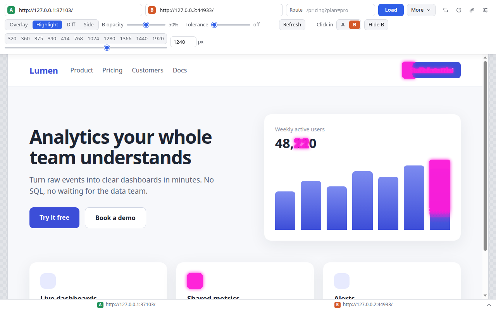

# Site Overlay Compare

A Chrome extension that lays two live websites on top of each other for pixel-perfect comparison, for example production and a rebuilt version of the same site. It highlights the differences, keeps scrolling, navigation, clicks and hover in sync, and lets you save a comparison as a link.



[Українською](README.uk.md)

## Install

**From the Chrome Web Store:** _link coming soon_.

**From an archive or from source** (Chrome 126 or newer):

1. Unzip the archive, or clone this repository, into a folder you will keep, for example `Documents/site-overlay`. Chrome reads the files from there, so don't delete or move it.
2. Open `chrome://extensions` and turn on **Developer mode** (top right).
3. Click **Load unpacked** and select the folder that contains `manifest.json`.
4. Pin the icon: 🧩 in the Chrome toolbar → 📌 next to Site Overlay Compare.

To update, replace the files in the same folder with the new version (or `git pull`), click ⟳ on the extension card in `chrome://extensions` and reload the comparison tab. If you skip the ⟳, the comparison tab notices that Chrome still runs the old version and offers a **Reload the extension** button. Keep the folder where it is: Chrome ties the extension's ID, and with it your settings, to the folder path. A copy loaded from another folder is a separate extension with default settings, so remove the old card.

## First comparison

1. Click the extension icon. A comparison tab opens.
2. Enter two addresses in **A** and **B**. A is the bottom layer, B is on top.
3. Optionally enter a shared **Route** such as `/pricing`. It is appended to both addresses. Leave it empty to open A and B as they are.
4. Press **Load** or Enter, then pick a width and a mode.

The protocol is optional: addresses open over `https://`, while `localhost` and `127.x.x.x` open over `http://`.

## Modes

| Button        | What it shows                                                |
| ------------- | ------------------------------------------------------------ |
| **Overlay**   | B over A with adjustable opacity                             |
| **Highlight** | Differences pulse in a bright accent colour over the overlay |
| **Diff**      | Matching pixels are black, differences glow                  |
| **Side**      | Both sites next to each other, always fitted to the window   |

**Highlight** is computed from screenshots of the tab after loading, scrolling, clicking or changing settings. While you scroll, the highlight hides and comes back about a second later. If the page changed by itself (an animation, a carousel), press **Refresh**.

**Tolerance** (Highlight only) hides differences thinner than the chosen thickness, such as the edge of a block shifted by 1–2 px. Large blocks stay highlighted. Text strokes are thin as well, so from "up to 4 px" changed text may disappear from the highlight. Keep it off or at "up to 2 px" when checking copy.

## Controls

- **Width:** breakpoint buttons, the slider under them (it sits under a button when the width matches it and moves smoothly in between) or any number.
- **Click in A/B:** which layer receives clicks and scrolling in overlay modes.
- **Hide B:** removes the top layer for a moment.

The **More** menu holds what you set once per comparison:

- **Sync scroll:** by pixels (for pixel-perfect checks) or by page height percentage (for pages of different length).
- **Follow navigation:** navigate in one layer and the other opens the same route. Works for SPAs too. If a layer leaves its base address, the other stays where it is.
- **Mirror actions:** an action in one site is repeated in the other, and the status line says how the target was found. Buttons are matched by text, by the label next to them (for example "Font size: A A A") and by their order, so this works even when the two sites use different markup. Hover is passed by position, so menus and hover effects open in both sites, whether they use CSS `:hover` or JavaScript. Passwords and files are never mirrored.
- **Fit to window:** scales the sites down when the width is larger than the window. Side by side always fits.
- **Offset B:** shifts the top layer by X/Y, for example when the headers differ in height.

And around them:

- The icons next to **Load**: swap A and B, reload the open pages, copy a link to this comparison, open the settings.
- The address open in each layer is shown under its screen: under each site in side by side, A on the left and B on the right in the other modes. Status messages pop up just above.
- The arrow in the bottom right corner hides the whole toolbar, so the sites get the full height.
- **Shortcuts:** Alt+1 / Alt+2 pick the active layer, Alt+H hides B, Alt+D toggles difference, Alt+T hides or shows the toolbar.

## Settings

Open them with the settings icon in the toolbar, or right-click the extension icon → **Options**. Changes are saved right away and apply to comparison tabs that are already open.

- **Breakpoint widths:** add your own widths, remove the ones you don't use, or restore the defaults.
- **Modes:** hide modes you don't need. At least one stays on.
- **Features:** switch off synced scrolling, follow navigation, mirroring of clicks, hover or typing (each on its own), Offset B, keyboard shortcuts or comparison links. A feature that is off disappears from the toolbar and doesn't run at all. With shortcuts off, Alt+1, Alt+2, Alt+H and Alt+D reach the sites.
- **Appearance:** light, dark or system theme, the colour of the difference highlight, and whether it pulses.

Settings are stored with `chrome.storage.sync`, so if Chrome sync is on, they follow you to your other computers.

> **Careful with mirroring on production.** These are real clicks on a real site: a "Delete" or "Pay" button pressed in one layer is pressed in the other too. Mirroring is off by default, and while it is on the toolbar shows a **Mirroring on** reminder; click it to turn mirroring off.

## Links to a comparison

The copy link button copies a link like this:

```
https://site-overlay.invalid/?a=prod.example.com&b=new.example.com&route=/pricing&w=1440&mode=highlight&tol=1
```

Opening it starts the comparison right away, so links are handy in notes, Markdown files and bookmarks, and can be shared with anyone who has the extension. `site-overlay.invalid` never resolves: the extension intercepts the request before it leaves the browser.

| Parameter | Value                                                                                   | Required |
| --------- | --------------------------------------------------------------------------------------- | -------- |
| `a`, `b`  | Site addresses                                                                          | yes      |
| `route`   | Shared path                                                                             | no       |
| `w`       | Width in px, 200 to 3840                                                                | no       |
| `mode`    | `overlay`, `highlight`, `difference` or `side` (buttons Overlay, Highlight, Diff, Side) | no       |
| `tol`     | Tolerance for `highlight`, 0 to 5, value × 2 = thickness in px                          | no       |

When `w`, `mode` or `tol` is missing, your last settings are used. Encode `?`, `&` and `#` inside `route`; the copy link button does this for you.

A link opened from a web page (a web chat, a wiki, webmail) only fills in the fields, and you press **Load** yourself. This keeps other websites from starting a comparison on their own. Links opened from desktop apps and local files load right away.

## Troubleshooting

| What you see                                                     | What to do                                                                                                    |
| ---------------------------------------------------------------- | ------------------------------------------------------------------------------------------------------------- |
| A link shows "This site can't be reached"                        | The extension is not installed or is disabled. Check `chrome://extensions`                                    |
| A layer stays empty or the site opens on its own                 | The site breaks out of iframes with JavaScript. Such sites can't be compared                                  |
| A site doesn't keep you signed in                                | Inside an iframe the site counts as third-party. Allow third-party cookies for it in Chrome settings          |
| The highlight flickers or shows noise                            | The page has animations or a carousel. Press "Refresh" or raise the tolerance                                 |
| A hover effect doesn't appear in the other site                  | Its styles come from another domain (a CDN), and the browser doesn't let extensions read them                 |
| After switching "Click in", a menu stays open in the other layer | Chrome doesn't clear hover in a layer that stopped receiving the mouse. Switch back and move the pointer away |
| Inner scroll areas don't sync                                    | Inner blocks are matched by CSS path. If the markup differs, they can't find each other                       |

## Privacy and permissions

The extension collects nothing and sends nothing anywhere. See [PRIVACY.md](PRIVACY.md).

| Permission              | Why                                                                                                                                                                                                                                             |
| ----------------------- | ----------------------------------------------------------------------------------------------------------------------------------------------------------------------------------------------------------------------------------------------- |
| Access to all sites     | To open any two sites in the comparison tab, sync them and take screenshots of that tab for the difference highlight                                                                                                                            |
| `declarativeNetRequest` | To remove `X-Frame-Options` and `Content-Security-Policy` from responses loaded into the comparison tab's iframes, so sites that forbid framing can be compared. The rule is limited to that tab and removed when the tab leaves the comparison |
| `webRequest`            | To catch `https://site-overlay.invalid/` links and open them as a comparison                                                                                                                                                                    |
| `storage`               | To remember your settings                                                                                                                                                                                                                       |

The content script only acts inside the comparison tab's frames. In ordinary tabs it does nothing.

## Development

There is no build step: the repository root is the extension, written in plain ES modules.

```
manifest.json
compare.html, options.html   the comparison tab and the options page
src/background.js            opens the tab, turns comparison links into comparisons
src/content.js               runs inside each site frame: reports and repeats user actions
src/compare/                 the comparison tab, one module per concern (state, layout, diff, …)
src/options/                 the options page
src/shared/                  settings and i18n helpers used by all of the above
styles/                      theme tokens and the two pages' styles
tests/                       end-to-end tests
store/                       Chrome Web Store listing, screenshots and the demo pages behind them
```

The comparison tab talks to the content scripts over `chrome.runtime` ports, so scripts of the compared sites can neither read those messages nor forge them. The protocol is described at the top of [src/content.js](src/content.js).

You need Node.js 20+ and Google Chrome 126+.

```bash
npm install          # ESLint and Prettier only; the extension has no dependencies
npm test             # end-to-end tests in headless Chrome, driven over the DevTools protocol
npm run lint         # ESLint and a Prettier check
npm run build        # dist/: a zip for the Chrome Web Store and one for "Load unpacked"
npm run screenshots  # re-renders store/images from store/demo
```

## License

[MIT](LICENSE)
